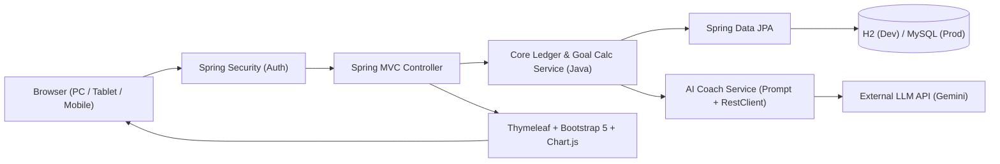
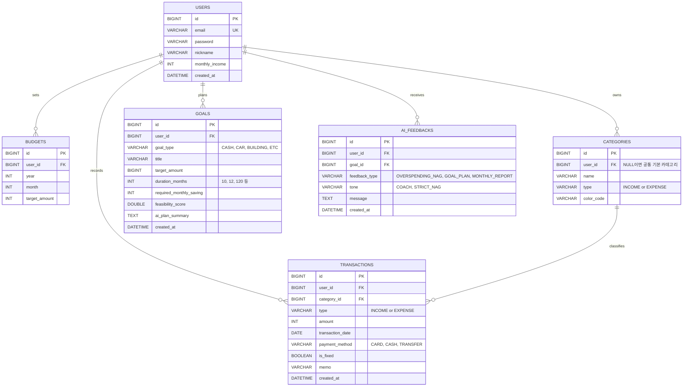

# PNS (Personal Net-worth & Spending) 프로젝트 기획서

> **대학교 Java 웹 프로그래밍 기말 프로젝트 기획안**  
> **소속**: 동명대학교 인공지능응용학과  
> **팀원**: 변의겸, 차승제 (2인 팀 프로젝트)  
> **저장소**: https://github.com/opiniom/PNS

---

## 1. 프로젝트 개요

### 1.1 프로젝트명
- **PNS (Personal Net-worth & Spending)** — AI 목표 코칭 기반 반응형 웹 가계부 서비스

### 1.2 개발 배경 및 목적
- 기존 가계부 서비스는 대부분 **이미 쓴 돈을 기록하는 '과거 회고형'**에 머물러 있어, 사용자가 실제로 저축 습관을 바꾸거나 장기 목표를 달성하도록 유도하는 힘이 부족합니다.
- 또한 모바일 전용 앱은 PC에서 전체 월간 소비를 분석하기 불편하고, 엑셀은 모바일에서 즉각 기록하기 어렵습니다.
- 본 프로젝트는 **Java(Spring Boot)** 백엔드와 **반응형 웹(Responsive Web)** UI로 가계부의 모든 기본 기능을 완벽히 제공하면서, **인공지능응용학과**의 강점을 살린 **AI 목표 달성 시뮬레이터 및 과소비 잔소리 코치**를 결합한 **미래 지향형 스마트 가계부**를 구축하는 것을 목표로 합니다.

### 1.3 핵심 차별점 (AI 재무 코치)
1. **구체적 목표 & 기간 시뮬레이션**: 단순 저축액이 아닌 **목표 유형(목돈 금액, 내 차 구매, 내 집/건물 마련 등)**과 **목표 기간(10개월, 1년, 10년 등)**을 설정
2. **AI 달성 가능성 진단 & 월 저축 플랜**: 사용자의 수입·지출 데이터를 Java 엔진으로 정밀 계산하고, AI가 **달성 가능성(%)**, **매달 모아야 할 권장 저축액**, **카테고리별 절약 전략**을 맞춤형으로 제시
3. **AI 과소비 잔소리(경고 & 피드백)**: 목표 저축액이나 월 예산 대비 과소비가 감지되면, AI가 현재 목표와 연결해 현실적이고 유쾌한 **맞춤형 잔소리(코칭 피드백)**를 제공 (예: *"이번 달 배달비 12만 원 초과! 이 페이스면 1년 뒤 내 차 구매가 3개월 미뤄집니다!"*)

---

## 2. 핵심 기능 명세

### 2.1 기본 가계부 전체 기능 (Core Ledger)
| 영역 | 기능명 | 상세 설명 |
| :--- | :--- | :--- |
| **회원 관리** | 회원가입 / 로그인 / 로그아웃 | Spring Security 기반 세션 인증, BCrypt 비밀번호 암호화, 마이페이지 관리 |
| **수입·지출 관리** | 거래 내역 CRUD | 날짜, 유형(수입/지출), 금액, 카테고리, 결제수단(카드/현금/이체), 메모 등록·수정·삭제 |
| **고정 지출 관리** | 반복 지출 템플릿 | 월세, 통신비, 구독료 등 매월 고정 지출 등록 및 자동/원클릭 반영 |
| **캘린더 & 대시보드** | 월별 요약 및 일별 조회 | 월 총 수입·총 지출·순 저축액 요약 카드, 캘린더 일별 지출 현황, 최근 거래 목록 |
| **검색·필터** | 다중 조건 조회 | 기간(월별/직접 지정), 유형, 카테고리, 결제수단, 메모 키워드 검색 및 정렬 |
| **통계 시각화** | 소비 패턴 리포트 | Chart.js 기반 카테고리별 지출 비율(도넛 차트), 월별 수입·지출·저축 추이(막대/선 차트) |
| **예산 관리** | 월별·카테고리별 예산 | 목표 예산 설정, 실시간 소비율 프로그레스 바, 80% 주의 / 100% 초과 경고 |

### 2.2 차별화 기능 (AI 재무 코칭)
| 영역 | 기능명 | 상세 설명 |
| :--- | :--- | :--- |
| **목표 시뮬레이터** | 목표·기간 설정 & AI 플랜 | 목표 유형(금액/차/건물 등), 목표 금액, 목표 기간(10개월·1년·10년 등) 입력 → Java 계산 엔진이 필요 월 저축액·달성률을 산출하고 AI가 달성 가능성 분석 및 맞춤형 절약 플랜 제시 |
| **과소비 잔소리** | 실시간 AI 과소비 피드백 | 지출 등록 시 예산 초과 또는 목표 저축 페이스 이탈 감지 → AI가 사용자의 목표와 최근 소비 내역을 근거로 잔소리/코칭 메시지 생성 (말투 모드 선택: 부드러운 코치 / 팩폭 잔소리) |
| **AI 월간 리포트** | 소비 습관 요약 | 월말 기준 가장 많이 줄일 수 있는 카테고리 TOP 3와 다음 달 권장 행동 제안 |

*(확장/선택 기능)*: CSV/엑셀 내보내기, 다크 모드 지원

---

## 3. 기술 스택 및 아키텍처 전략

### 3.1 기술 스택
| 구분 | 기술 | 선정 이유 |
| :--- | :--- | :--- |
| **Language** | Java 17 (LTS) | Spring Boot 3.x 공식 지원 LTS 버전, 안정적인 객체지향 설계 |
| **Backend** | Spring Boot 3.x, Spring MVC, Spring Security | 내장 Tomcat 기반 빠른 개발, 표준 인증/인가(BCrypt) 구현 |
| **ORM** | Spring Data JPA | 자바 Entity 중심 데이터 모델링 및 반복 SQL 최소화 |
| **AI Integration** | LLM API (Gemini API 등) + Spring `RestClient` | **하이브리드 구조**: 정확한 수치 계산은 Java가 담당하고, 자연어 전략·잔소리 생성은 AI API가 담당하여 환각(계산 오류) 방지 |
| **Frontend** | Thymeleaf, HTML5, CSS3, JavaScript (ES6+) | Spring Boot 공식 템플릿 엔진, 단일 프로젝트로 빠른 개발 |
| **UI / Chart** | Bootstrap 5, Chart.js | PC·태블릿·모바일 반응형 그리드 및 직관적 데이터 시각화 |
| **Database** | **H2 (개발용) + MySQL 8.0 (시연/운영용)** | 개발 시 H2로 2인 협업 환경 충돌 방지, 시연 시 Profile 전환만으로 MySQL 영구 저장 |
| **Build / VCS** | Gradle, Git & GitHub | 의존성 관리 자동화 및 GitHub(`opiniom/PNS`) 협업 |

### 3.2 시스템 아키텍처 (Java 계산 + AI 코칭 하이브리드)

---

## 4. 데이터베이스 설계 (ERD)

---

## 5. 반응형 UI/UX 화면 설계

| 화면 | 주요 구성 요소 | 반응형 전략 (PC vs Mobile) |
| :--- | :--- | :--- |
| **메인 대시보드** | 월 수입/지출/저축 카드, 목표 달성 게이지, **AI 오늘의 잔소리 배너**, 최근 거래 | PC: 좌측 사이드바 + 3열 요약 + 우측 AI 코치 위젯 / Mobile: 하단 탭바 + 1열 카드 + 빠른 입력(+) FAB |
| **거래 내역 & 캘린더** | 월별 캘린더, 다중 필터(기간/카테고리/결제수단), 고정지출, 등록 모달 | PC: 좌측 캘린더 + 우측 테이블 / Mobile: 상단 미니 캘린더 + 하단 카드 리스트 |
| **AI 목표 시뮬레이터** | 목표 유형 선택(금액/차/건물), 기간 슬라이더(10개월~10년), 가능성 게이지, 월 저축액 & AI 전략 | PC: 좌측 입력 폼 + 우측 시뮬레이션 결과 / Mobile: 세로 스텝 카드형 |
| **통계 & AI 리포트** | 카테고리 도넛 차트, 월별 추이 막대 차트, AI 과소비 잔소리 히스토리 | PC: 2열 차트 그리드 / Mobile: 1열 세로 스택 |
| **예산 & 설정** | 월별 예산 설정, 커스텀 카테고리, AI 잔소리 강도(부드럽게/팩폭) 설정 | PC/Mobile 공통 반응형 폼 |

---

## 6. 2인 팀 역할 분담 (동명대학교 인공지능응용학과)

| 팀원 | 담당 영역 | 주요 산출물 |
| :--- | :--- | :--- |
| **변의겸** *(Backend Core, DB & AI Coach)* | • 프로젝트 초기 세팅, Git 저장소 관리, DB/JPA Entity 설계 • Spring Security 회원 인증 및 월별 예산 관리 • **목표 달성 수치 계산 엔진 + AI API(목표 플랜·과소비 잔소리) 연동** • MySQL 전환 및 최종 시연 환경 구성 | `User`, `Budget`, `Goal`, `AiFeedback` 도메인 인증·예산·AI 코치 Service/Controller |
| **차승제** *(Responsive UI, Ledger CRUD & Analytics)* | • Bootstrap 5 + Thymeleaf 반응형 공통 레이아웃 및 화면 설계 • **수입·지출 CRUD, 고정지출, 캘린더 및 검색·필터링 구현** • Chart.js 소비 통계 대시보드 및 AI 시뮬레이터/잔소리 UI 연동 • 모바일·PC 크로스 브라우저 반응형 QA | `Transaction`, `Category` 도메인 전체 반응형 웹 템플릿 & 차트 시각화 |
| **공통** | • 요구사항 정의, ERD 검토, 프롬프트 튜닝(AI 잔소리 품질 개선) • Git PR 코드 리뷰, 통합 테스트, 중간/기말 발표 자료 제작 | 기획서, 중간/기말 PPT, README |

---

## 7. 개발 일정 (WBS — 중간 발표 ~ 기말고사)

| 주차 | 단계 | 주요 작업 내용 | 산출물 |
| :--- | :--- | :--- | :--- |
| **1주차** | 기획 & 설계 | 요구사항 확정, ERD 및 반응형 화면 설계, **중간 발표 진행** | 기획서(`PLAN.md`), 중간 발표 PPT |
| **2주차** | 기반 구축 | Spring Boot 프로젝트 세팅, JPA Entity/Repository, 회원 인증, 반응형 공통 레이아웃 | 실행 가능한 기본 앱 & 로그인 |
| **3주차** | 가계부 핵심 | 수입·지출 CRUD, 고정지출, 캘린더 조회, 검색·필터링, 예산 관리 구현 | 기본 가계부 기능 완성 |
| **4주차** | AI 차별화 & 통계 | Chart.js 통계, **AI 목표 시뮬레이터(금액/차/건물·기간) 및 과소비 잔소리 기능** 연동 | 핵심 차별화 기능 포함 MVP 완성 |
| **5주차** | 테스트 & 시연 | AI 프롬프트 튜닝, PC/모바일 반응형 QA, MySQL 연동 검증, 기말 발표 시연 준비 | 최종 소스코드, 기말 발표 자료 |

---

## 8. 중간 발표 PPT 구성안 (총 11장, 5~10분 발표 기준)

1. **표지**: PNS — AI 목표 코칭 기반 반응형 웹 가계부 (동명대학교 인공지능응용학과 변의겸·차승제)
2. **기획 배경 및 문제 정의**: 과거 기록 중심 가계부의 한계 → 미래 목표 지향형 AI 가계부의 필요성
3. **서비스 핵심 가치 & 차별점**: 기본 가계부 풀스펙 + AI 목표 시뮬레이터 + AI 과소비 잔소리
4. **기능 명세 (Core Ledger + AI Coach)**: 기본 가계부 7대 기능과 AI 차별화 3대 기능 구조
5. **핵심 차별점 시나리오 (AI 목표 & 잔소리)**: 목표(차/건물/금액)·기간(10개월/1년/10년) → 월 저축액·가능성 진단 → 과소비 실시간 잔소리 예시
6. **기술 스택 및 하이브리드 전략**: Spring Boot + Thymeleaf + H2/MySQL + Java 수치 계산 & LLM API 역할 분리
7. **시스템 아키텍처**: Spring MVC + JPA + AI Coach Service 흐름도
8. **데이터베이스 설계 (ERD)**: 6개 핵심 테이블(`USERS`, `CATEGORIES`, `TRANSACTIONS`, `BUDGETS`, `GOALS`, `AI_FEEDBACKS`) 관계
9. **반응형 UI/UX 화면 설계**: Desktop vs Mobile 레이아웃 비교 및 AI 코치 위젯 배치
10. **2인 팀 역할 분담 & 5주 개발 일정 (WBS)**: 변의겸·차승제 담당 영역 및 기말고사까지 주차별 마일스톤
11. **기대 효과 및 Q&A**: 전공(AI + Java 웹) 융합 성과 요약 및 질의응답
