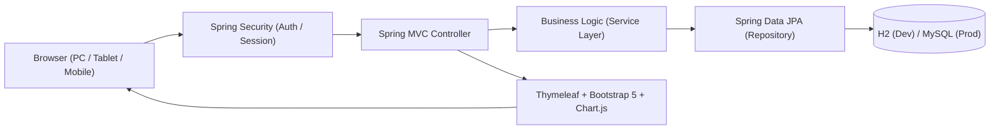
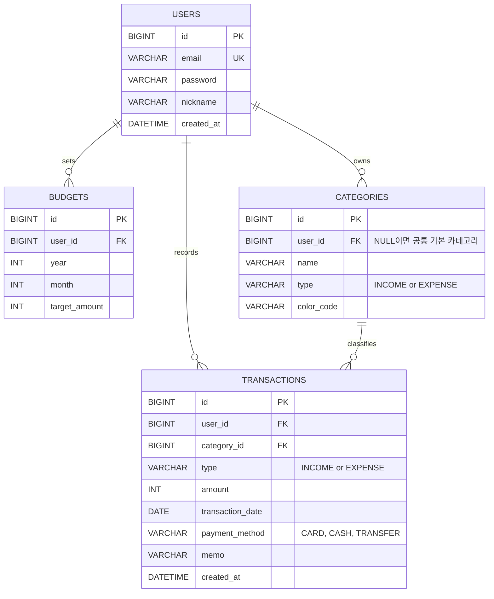

# PNS (Personal Net-worth & Spending) 프로젝트 기획서

> **대학교 Java 웹 프로그래밍 기말 프로젝트 기획안**  
> **프로젝트 유형**: 2인 팀 프로젝트  
> **저장소**: https://github.com/opiniom/PNS

---

## 1. 프로젝트 개요

### 1.1 프로젝트명
- **PNS (Personal Net-worth & Spending)** — 반응형 웹 가계부 서비스 *(추후 팀 합의에 따라 서비스명 변경 가능)*

### 1.2 개발 배경 및 목적
- 대학생 및 사회초년생은 카드, 계좌이체, 간편결제 등 다양한 결제 수단을 사용하며 지출 관리에 어려움을 겪습니다.
- 기존 모바일 전용 앱은 PC에서 전체 월간 내역을 한눈에 보거나 정리하기 불편하고, 엑셀 가계부는 모바일에서 즉각 기록하기 어렵습니다.
- 본 프로젝트는 **Java(Spring Boot)** 기반의 안정적인 백엔드와 **반응형 웹(Responsive Web)** 프론트엔드를 결합하여, **별도 앱 설치 없이 PC·태블릿·모바일 어디서나 동일하게 사용할 수 있는 가계부 서비스**를 구현하는 것을 목표로 합니다.

### 1.3 핵심 목표
1. **객체지향 설계 및 Spring MVC 실전 적용**: 계층형 아키텍처(Controller - Service - Repository)와 JPA 엔티티 설계를 통한 유지보수성 확보
2. **반응형 UI/UX 구현**: 모바일에서는 빠른 입력 중심, 데스크톱에서는 대시보드·통계 분석 중심으로 최적화
3. **데이터 시각화 기반 소비 인사이트 제공**: 단순 기록을 넘어 카테고리별 지출 비율 및 예산 대비 소비 현황을 시각적으로 제공

---

## 2. 핵심 기능 명세

### 2.1 MVP (필수 구현 기능)
| 영역 | 기능명 | 상세 설명 |
| :--- | :--- | :--- |
| **회원 관리** | 회원가입 / 로그인 / 로그아웃 | Spring Security 기반 세션 인증, BCrypt 비밀번호 암호화, 본인 데이터만 접근 가능 |
| **거래 내역** | 수입·지출 CRUD | 날짜, 유형(수입/지출), 금액, 카테고리, 결제수단(카드/현금/이체), 메모 등록·조회·수정·삭제 |
| **대시보드** | 월별 요약 및 최근 내역 | 선택한 월의 총 수입, 총 지출, 순 잔액 요약 카드 및 일자별 내역 리스트 |
| **검색/필터** | 다중 조건 조회 | 기간(월별/직접 지정), 유형(수입/지출), 카테고리, 메모 키워드 검색 |
| **통계 분석** | 소비 패턴 시각화 | Chart.js 기반 카테고리별 지출 비율(도넛 차트) 및 최근 6개월 수입·지출 추이(막대 차트) |
| **예산 관리** | 월별 목표 예산 설정 | 월별 전체 예산 설정, 현재 지출 비율 프로그레스 바 표시, 80% 주의 / 100% 초과 경고 |

### 2.2 확장 기능 (여유 시 추가 구현)
- **고정 지출 관리**: 월세, 통신비, 구독 서비스 등 매월 반복되는 지출 템플릿
- **CSV 내보내기**: 선택한 월의 가계부 내역을 CSV 파일로 다운로드
- **다크 모드 지원**: 사용자 환경에 맞춘 라이트/다크 테마 전환

---

## 3. 기술 스택 및 데이터베이스 추천 전략

### 3.1 기술 스택
| 구분 | 기술 | 선정 이유 |
| :--- | :--- | :--- |
| **Language** | Java 17 (LTS) | 최신 LTS 버전으로 Spring Boot 3.x와 완벽 호환 및 안정성 확보 |
| **Backend** | Spring Boot 3.x, Spring MVC | 빠른 초기 설정, 내장 Tomcat, 자바 웹 표준 프레임워크 학습 효과 |
| **Security** | Spring Security | 세션 기반 인증/인가 및 비밀번호 암호화(BCrypt) 표준 구현 |
| **ORM** | Spring Data JPA | 자바 객체(Entity) 중심 데이터 모델링, 반복적인 SQL 작성 최소화 |
| **View / Frontend** | Thymeleaf, HTML5, CSS3, JavaScript (ES6+) | Spring Boot 공식 권장 템플릿 엔진, 별도 프론트 서버 없이 빠른 개발 |
| **UI / Chart** | Bootstrap 5, Chart.js | 검증된 반응형 그리드 시스템 및 직관적인 통계 차트 구현 |
| **Build / VCS** | Gradle, Git & GitHub | 의존성 관리 자동화 및 2인 팀 협업(Branch / PR 전략) |

### 3.2 데이터베이스(DB) 추천안: **H2 (개발용) + MySQL 8.0 (시연/운영용)**
> **추천 이유**:
> 1. **2인 협업 효율성 (H2)**: 개발 단계에서는 별도의 DB 서버 설치 없이 Spring Boot 실행만으로 동작하는 `H2`를 사용해 팀원 간 환경 충돌을 방지합니다.
> 2. **실무형 영구 저장소 (MySQL / MariaDB)**: 기말 시연 및 최종 제출 시에는 `application-prod.yml` 프로필 전환만으로 MySQL에 데이터를 영구 저장할 수 있습니다.
> 3. **JPA 추상화**: Spring Data JPA를 사용하므로 H2에서 MySQL로 전환할 때 Java 코드를 수정할 필요가 거의 없습니다.

---

## 4. 시스템 아키텍처



### 패키지 구조 (예정)
```text
com.pns.ledger
├── config          # SecurityConfig, WebConfig
├── domain          # JPA Entities (User, Category, Transaction, Budget)
├── dto             # Request/Response DTOs
├── repository      # Spring Data JPA Repositories
├── service         # Business Logic (AuthService, TransactionService, StatService, BudgetService)
└── controller      # MVC Controllers & REST Endpoints (Chart 데이터용)
```

---

## 5. 데이터베이스 설계 (ERD)



---

## 6. 반응형 UI/UX 화면 설계

| 화면 | 주요 구성 요소 | 반응형 전략 (PC vs Mobile) |
| :--- | :--- | :--- |
| **로그인 / 회원가입** | 이메일·비밀번호 폼, 유효성 검증 메시지 | PC: 중앙 카드형(400px) / Mobile: 전체 너비 폼 |
| **메인 대시보드** | 월 선택기, 수입/지출/잔액 3종 카드, 예산 게이지, 최근 거래 목록 | PC: 좌측 사이드바 + 3열 요약 카드 / Mobile: 하단 네비게이션 + 1열 스택 + 우측 하단 빠른 추가(+) 버튼 |
| **거래 내역 목록** | 기간/카테고리/키워드 필터, 거래 리스트, 등록·수정 모달 | PC: 테이블 형태 / Mobile: 카드 리스트 형태(터치 친화적) |
| **통계 리포트** | 카테고리별 도넛 차트, 월별 추이 막대 차트, TOP 3 지출 항목 | PC: 차트 2열 배치 / Mobile: 차트 1열 세로 배치 |
| **예산 & 설정** | 월별 목표 예산 입력, 커스텀 카테고리 관리 | PC/Mobile 공통 폼 레이아웃, 직관적 컬러 선택기 |

---

## 7. 2인 팀 역할 분담

| 역할 | 담당 영역 | 주요 산출물 |
| :--- | :--- | :--- |
| **팀원 A** *(Backend Core & Auth/Stats)* | • 프로젝트 초기 세팅 및 DB/JPA Entity 설계<br>• 회원가입/로그인 및 Spring Security 인증<br>• 월별 예산 관리 및 통계 집계 로직/API<br>• MySQL 연동 및 최종 배포/시연 환경 구성 | `User`, `Budget` 도메인<br>인증·예산·통계 Service/Controller |
| **팀원 B** *(Frontend Responsive UI & Core CRUD)* | • Bootstrap 5 + Thymeleaf 반응형 공통 레이아웃<br>• 수입/지출 내역 CRUD (화면 + 백엔드)<br>• 검색·필터링 기능 및 카테고리 관리<br>• Chart.js 통계 대시보드 화면 연동 | `Transaction`, `Category` 도메인<br>반응형 HTML/CSS/JS 템플릿 전체 |
| **공통** | • 요구사항 정의 및 ERD 검토<br>• Git PR 코드 리뷰 및 통합 테스트<br>• 중간 발표 및 기말 최종 발표 자료 제작 | 기획서, 중간/기말 PPT, README |

---

## 8. 개발 일정 (WBS)

| 주차 | 단계 | 주요 작업 내용 | 산출물 |
| :--- | :--- | :--- | :--- |
| **1주차** | 기획 & 설계 | 요구사항 확정, ERD 및 화면 설계, **중간 발표 진행** | 기획서(`PLAN.md`), 중간 발표 PPT |
| **2주차** | 기반 구축 | Spring Boot 프로젝트 생성, Entity/Repository 구현, 회원 인증, 반응형 공통 레이아웃 | 실행 가능한 기본 웹 앱 & 로그인 기능 |
| **3주차** | 핵심 기능 | 수입/지출 CRUD, 카테고리 관리, 검색·필터링 기능 구현 | 가계부 핵심 입출력 완성 |
| **4주차** | 시각화 & 예산 | 대시보드 요약, Chart.js 통계 차트 연동, 월별 예산 및 경고 기능 구현 | 전체 MVP 기능 완성 |
| **5주차** | 테스트 & 마무리 | PC/모바일 반응형 QA, MySQL 전환 테스트, 버그 수정, 기말 발표 및 시연 준비 | 최종 소스코드, 기말 발표 자료 |

---

## 9. 중간 발표 PPT 구성안 (총 11장, 5~10분 발표 기준)

1. **표지**: 프로젝트명(PNS), 과목명, 팀원 이름, 발표일
2. **프로젝트 배경 및 목적**: 기존 가계부의 불편함과 반응형 웹 가계부의 필요성
3. **핵심 기능 소개**: MVP 6대 기능 + 확장 기능 로드맵
4. **기술 스택 및 DB 전략**: Java/Spring Boot + Thymeleaf + Bootstrap 5 + H2/MySQL 선정 이유
5. **시스템 아키텍처**: Spring MVC 계층 구조 및 요청-응답 흐름도
6. **데이터베이스 설계 (ERD)**: 4개 핵심 테이블 구조 및 관계
7. **반응형 UI/UX 화면 설계**: Desktop vs Mobile 와이어프레임 비교
8. **핵심 기능 시나리오**: 거래 등록 → 대시보드/예산/통계 실시간 반영 흐름
9. **2인 팀 역할 분담**: 팀원 A / 팀원 B 책임 영역 및 Git 협업 방식
10. **향후 개발 일정 (WBS)**: 중간 발표 이후 기말고사까지 주차별 마일스톤
11. **기대 효과 및 Q&A**: 학습 목표 달성 및 질의응답
